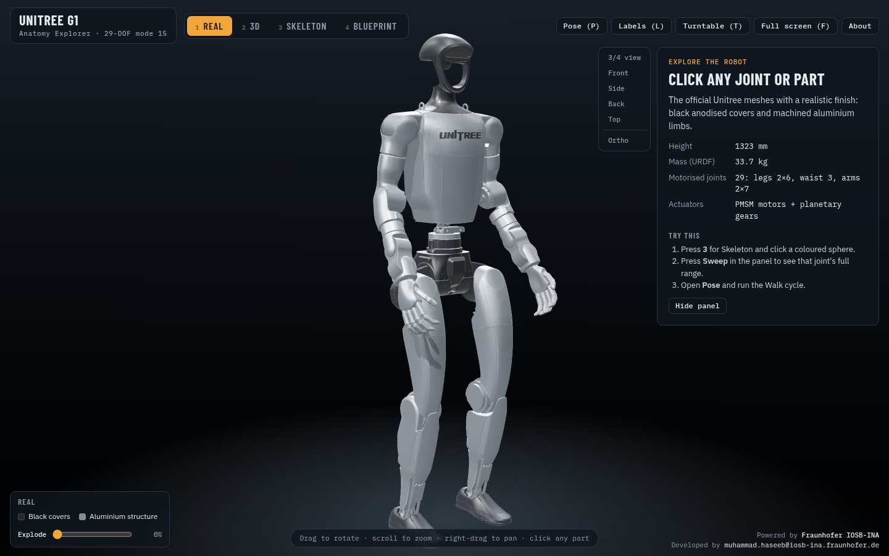
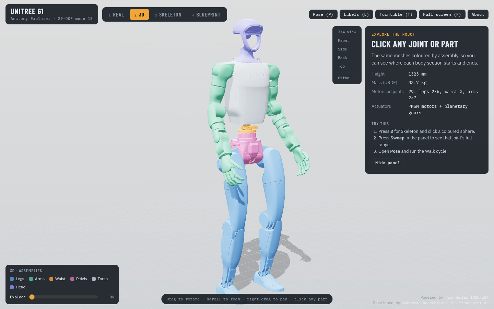
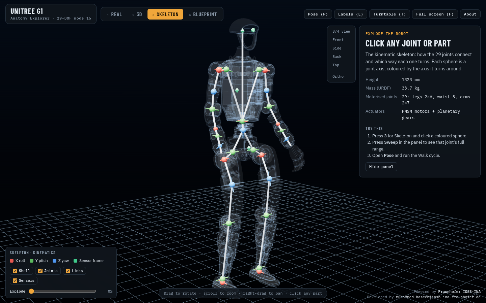
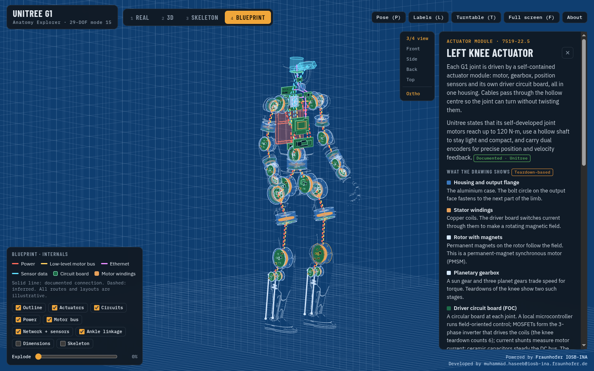

# Unitree G1 Anatomy Explorer

An interactive 3D model of the **Unitree G1** humanoid robot (29-DOF, URDF `g1_29dof_mode_15`) for teaching. It runs in any modern browser, on desktop or phone, and the downloaded file works fully offline.

**▶ Open online:** https://__USER__.github.io/unitree-g1-anatomy-explorer/
**⬇ Download (offline, one file):** [Unitree_G1_Anatomy_Explorer.zip](https://github.com/__USER__/unitree-g1-anatomy-explorer/releases/latest/download/Unitree_G1_Anatomy_Explorer.zip)

| Real | 3D | Skeleton | Blueprint |
|---|---|---|---|
|  |  |  |  |

## What it shows
- **Real:** Unitree's official meshes with a realistic finish.
- **3D:** the same robot, coloured by assembly (legs, arms, waist, pelvis, torso, head).
- **Skeleton:** the 29 joint axes and links. Red, green and blue mean the joint turns about X, Y or Z.
- **Blueprint:** an engineering X-ray drawing. It shows an actuator cutaway at every joint (windings, rotor, planetary gears, encoders, driver board, XT30 connectors), the torso and head electronics (RK3588S, Jetson Orin NX, power distribution, battery, Ethernet switch, I/O panel), and colour-coded wiring for power, the low-level motor bus, Ethernet and sensor data.

Click any joint, part, circuit board or wire to see its details: axis, range, torque, motor family, SDK motor index, connections, and the sources behind each fact. Every card is labelled **Documented**, **Teardown-based** or **Illustrative**.

## How to open the downloaded file
1. Download and unzip `Unitree_G1_Anatomy_Explorer.zip`.
2. Double-click `Unitree_G1_Anatomy_Explorer.html`. It opens in Chrome or Edge, with no internet or installation needed.

**Keys:**
- **1–4:** switch views
- **P:** poses (Stand, Wave, Squat, Reach, Walk cycle)
- **L:** labels
- **T:** turntable
- **O:** orthographic camera
- **R:** reset camera
- **F:** full screen
- **Esc:** close a panel

**Mouse:** drag to rotate, scroll to zoom, right-drag to pan. On phones: one finger rotates, two fingers zoom and pan.

## Accuracy
- **From Unitree's official URDF:** part shapes, joint positions, axes, limits, torque and speed limits, masses and sensor frames.
- **From Unitree's developer documentation:** joint order and SDK indices, I/O connectors, and the PC2 specification.
- **From public teardowns, marked as such:** internal electronics and actuator construction.
- **Illustrative:** positions, sizes and cable routes inside the robot, because Unitree does not publish them. This is a teaching model, not a manufacturing drawing, and it is not affiliated with or endorsed by Unitree Robotics.

Sources are listed in [SOURCES.md](SOURCES.md) and in the viewer's About panel.

## Rebuild from source
```bash
# 1. Unitree's robot description (BSD-3-Clause), about 111 MB
git clone --depth 1 --filter=blob:none --sparse https://github.com/unitreerobotics/unitree_ros source/repo
git -C source/repo sparse-checkout set robots/g1_description

# 2. Pack meshes + metadata, then assemble the single-file viewer
python3 build/pack_g1.py
python3 build/build_viewer.py   # -> dist/Unitree_G1_Anatomy_Explorer.html and docs/index.html

# 3. Offline browser test (headless Chrome, network blocked)
node --experimental-websocket build/test_offline.mjs
```
Requirements: Python 3 with NumPy, Node 20+, Google Chrome (for the test).

## Credits
Powered by **Fraunhofer IOSB-INA**. Developed by **muhammad.haseeb@iosb-ina.fraunhofer.de**.
Built with Three.js, with the help of Claude Code (Anthropic).
Robot geometry © Unitree Robotics (BSD-3-Clause). See [THIRD_PARTY_NOTICES.md](THIRD_PARTY_NOTICES.md).
